I build websites, booking systems, admin panels and Telegram bots for small businesses — salons, restaurants, shops, studios. In my spare time I take apart game files and make things out of them, mostly around Dota 2 and Minecraft.

### What a typical project looks like

Most client work lives in private repos, but it usually goes like this: a Next.js site with online booking and Stripe payments, a FastAPI + PostgreSQL backend, an admin panel the owner can actually use, and a Telegram bot that pings them about new orders.

### Stack

and for fun &nbsp;&nbsp; Minecraft mods and blinking LEDs

### Contact

Have a project? Write to me.

   &nbsp; &nbsp;

If something I made saved you time:

